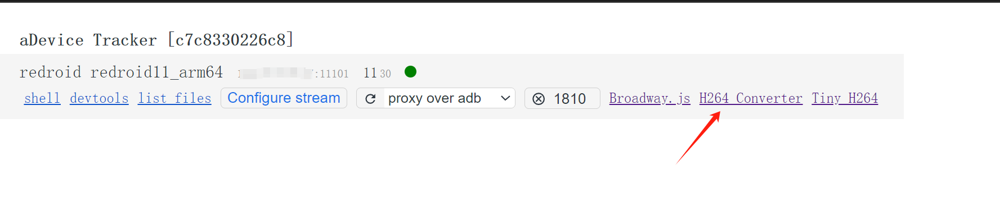
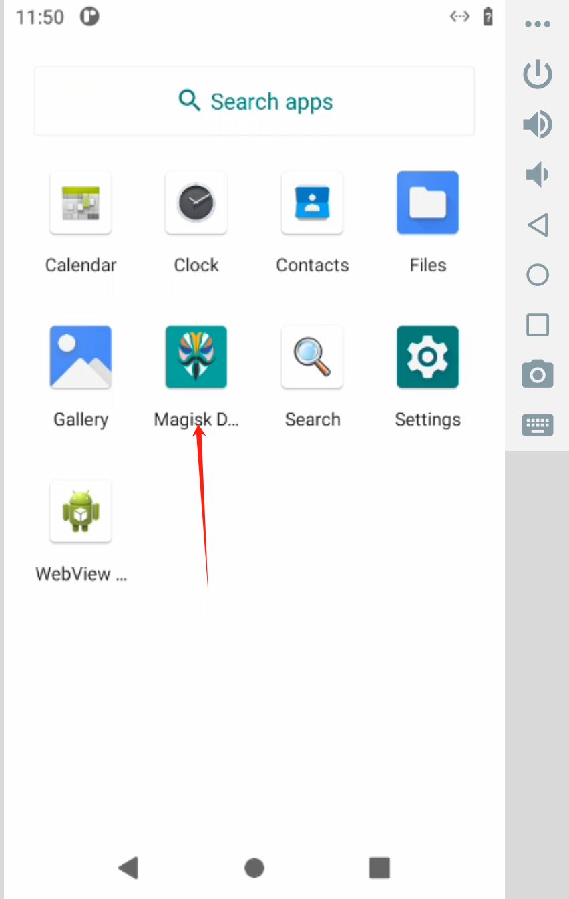
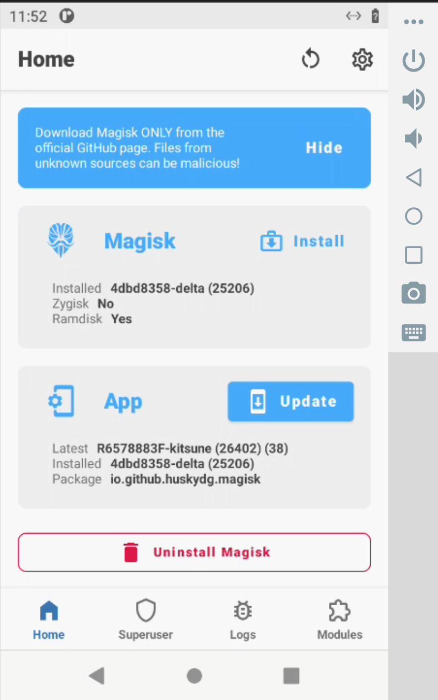
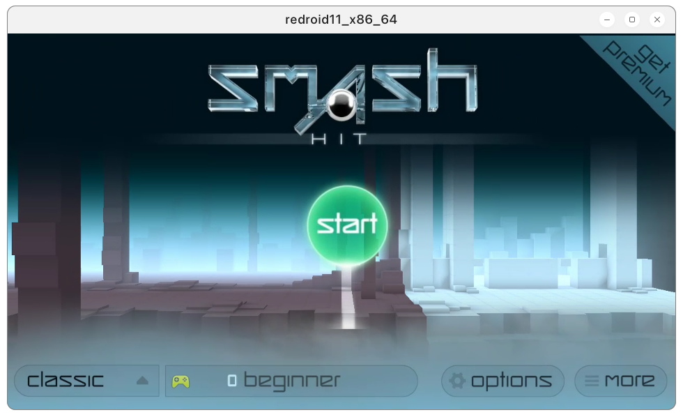
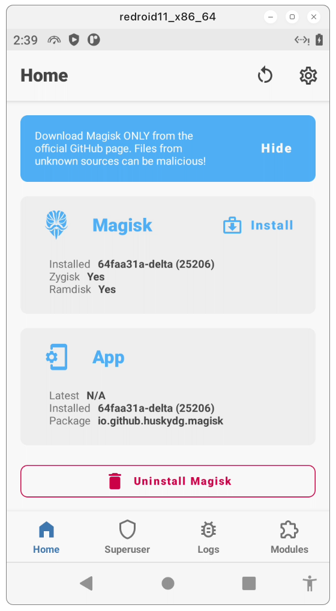
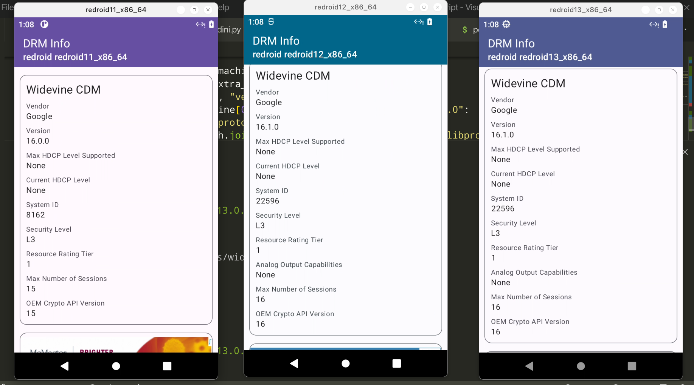
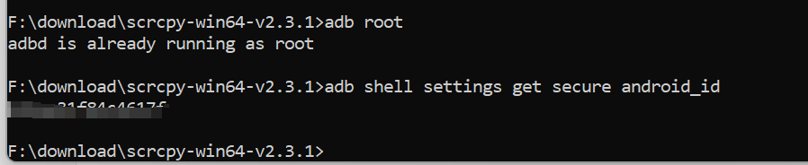

# redroid-script

[简体中文](README.zh-CN.md)

## Acerca de este fork

Este repositorio es un fork de [ayasa520/redroid-script](https://github.com/ayasa520/redroid-script).

El autor original ahora está actualizando activamente el proyecto principal. Este proyecto ya no se mantiene. Si tienes problemas o solicitudes de funciones relacionadas con el script, por favor envíalas al proyecto original.

Puedo subir imágenes para otras versiones de Android más adelante según la demanda.

## Imágenes precompiladas

Puedes usar las imágenes precompiladas a continuación si no deseas crear tu propia imagen.

### Imagen ARM64

Entorno probado: Oracle Cloud, Ubuntu 20.04.6 LTS, Linux `5.4.0-167-generic aarch64`, 4 núcleos de CPU y 24 GB de memoria.

Instala primero los módulos del kernel requeridos:

```bash
apt install linux-modules-extra-$(uname -r)
modprobe binder_linux devices="binder,hwbinder,vndbinder"
modprobe ashmem_linux
```

Ejecuta el contenedor:

```bash
docker run -itd --restart=always --privileged \
  --name a11_1 \
  -v ~/redroid/redroid01/data:/data \
  -p 11101:5555 \
  abing7k/redroid:a11_magisk_arm \
  androidboot.redroid_fps=30 \
  androidboot.redroid_gpu_mode=guest
```

### Imagen AMD64

La imagen AMD64 incluye soporte de traducción ARM, pero la compatibilidad es limitada. Algunas aplicaciones pueden no ejecutarse correctamente.

Instala primero los módulos del kernel requeridos:

```bash
apt install linux-modules-extra-$(uname -r)
modprobe binder_linux devices="binder,hwbinder,vndbinder"
modprobe ashmem_linux
```

En algunos sistemas AMD64, estos módulos del kernel pueden no permanecer cargados después de un reinicio. Si eso ocurre, agrega los comandos anteriores a un script de inicio.

Ejecuta el contenedor:

```bash
docker run -itd --restart=always --privileged \
  --name a11_01 \
  -v ~/redroid/redroid01/data:/data \
  -p 11101:5555 \
  abing7k/redroid:a11_magisk_ndk_amd \
  androidboot.redroid_gpu_mode=auto \
  ro.product.cpu.abilist0=x86_64,arm64-v8a,x86,armeabi-v7a,armeabi \
  ro.product.cpu.abilist64=x86_64,arm64-v8a \
  ro.product.cpu.abilist32=x86,armeabi-v7a,armeabi \
  ro.dalvik.vm.isa.arm=x86 \
  ro.dalvik.vm.isa.arm64=x86_64 \
  ro.enable.native.bridge.exec=1 \
  ro.dalvik.vm.native.bridge=libndk_translation.so \
  ro.ndk_translation.version=0.2.2
```

Etiquetas de imagen disponibles:

1. `abing7k/redroid:a11_magisk_arm`
2. `abing7k/redroid:a11_gapps_arm`
3. `abing7k/redroid:a11_gapps_magisk_arm`
4. `abing7k/redroid:a11_arm`
5. `abing7k/redroid:a11_magisk_ndk_amd`
6. `abing7k/redroid:a11_gapps_magisk_ndk_amd`
7. `abing7k/redroid:a11_gapps_ndk_amd`
8. `abing7k/redroid:a11_ndk_amd`

## Conexión con scrcpy-web

Puedes usar `scrcpy-web` para conectarte al contenedor de Android:

```bash
docker run -itd --privileged --name scrcpy-web -p 8000:8000/tcp emptysuns/scrcpy-web:v0.1
docker exec -it scrcpy-web adb connect your_server_ip:11101
```

Abre `http://your_server_ip:8000` en tu navegador y haz clic en **H264 Converter**.



Desliza hacia arriba desde la parte inferior de la pantalla.





## Crear tu propia imagen

### Script Remote-Android

Este script añade OpenGApps, Magisk, traducción libndk y Widevine L3 a una imagen ReDroid sin tener que recompilar la imagen completa.

Si el script no funciona, por favor abre una incidencia.

### Requisitos

- Docker or Podman
- `lzip`
- Dependencias de Python desde `requirements.txt`

Instala las dependencias de Python:

```bash
python3 -m pip install -r requirements.txt
```

### Entorno de ejecución de contenedores

El entorno de ejecución de contenedores predeterminado es Docker. Usa `-c` o `--container` para elegir entre Docker o Podman:

```text
-c {docker,podman}, --container {docker,podman}
```

### Versión de Android

Usa `-a` o `--android-version` para seleccionar la versión base de Android de ReDroid. Los valores soportados son `8.1.0`, `9.0.0`, `10.0.0`, `11.0.0`, `12.0.0`, `12.0.0_64only` y `13.0.0`. El valor predeterminado es `11.0.0`.

```bash
python3 redroid.py -a 11.0.0
```

### Agregar OpenGApps


```bash
python3 redroid.py -g
```

### Agregar traducción libndk



`libndk_translation` proviene de la imagen de firmware guybrush. Es posible que tenga un mejor rendimiento que `libhoudini` en sistemas AMD64.

El script solo instala la traducción libndk en hosts x86 o x86_64, y solo para Android `11.0.0`, `12.0.0` y `12.0.0_64only`.

```bash
python3 redroid.py -n
```

### Agregar Magisk



Zygisk y módulos como LSPosed deberían funcionar.

```bash
python3 redroid.py -m
```

### Agregar Widevine DRM L3



```bash
python3 redroid.py -w
```

### Ejemplo

Este comando agrega OpenGApps, Magisk, traducción libndk y Widevine L3 a la misma imagen ReDroid:

```bash
python3 redroid.py -a 11.0.0 -gmnw
```

En un host x86_64, la etiqueta de imagen generada es:

```text
redroid/redroid:11.0.0_gapps_ndk_magisk_widevine
```

Luego inicia un contenedor desde la imagen generada. Si el script imprime una etiqueta diferente, usa la etiqueta impresa por el script.

```bash
docker run -itd --restart=always --privileged \
  --name a11_1 \
  -v ~/redroid/redroid01/data:/data \
  -p 11101:5555 \
  redroid/redroid:11.0.0_gapps_ndk_magisk_widevine \
  androidboot.redroid_gpu_mode=guest
```

## Solución de problemas

### Magisk instalado: N/A

Basado en comentarios de algunos usuarios de WayDroid, cambiar el kernel puede solucionar este problema:

https://t.me/WayDroid/126202

### El dispositivo no está certificado por Play Protect

Ejecuta los siguientes comandos en el host:

```bash
adb root
adb shell settings get secure android_id
```



Copia el Android ID y regístralo aquí:

https://www.google.com/android/uncertified/

### libndk no funciona

Este fork solo se ha verificado con `redroid/redroid:11.0.0`. Habilitar Zygisk podría romper libndk para aplicaciones de 32 bits, pero las aplicaciones ARM64 aún pueden funcionar.

### libhoudini no funciona

No he podido hacer que ninguna versión de `libhoudini` funcione en ReDroid.

### Instalar archivos APK

Usa `adb install` para instalar archivos APK:

```bash
adb install app.apk
```

## Créditos

1. [remote-android](https://github.com/remote-android)
2. [waydroid_script](https://github.com/casualsnek/waydroid_script)
3. [Magisk Delta](https://huskydg.github.io/magisk-files/)
4. [vendor_intel_proprietary_houdini](https://github.com/supremegamers/vendor_intel_proprietary_houdini)
